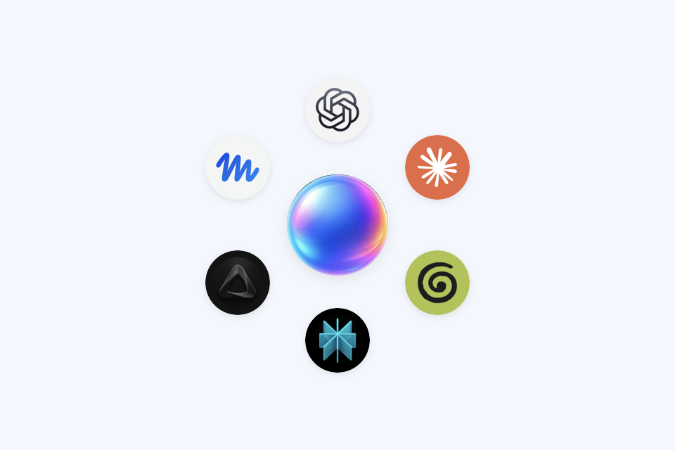

# My AI Bubble

Created by [Stu Collett](https://github.com/i-am-stu). A small personal project to keep the AI apps I use within reach.

A small floating launcher for the AI apps on your Mac. Add your apps, move the bubble wherever it suits you, and click an app bubble to bring its window forward.

## [Download My AI Bubble for Mac (.dmg)](https://github.com/i-am-stu/my-ai-bubble/releases/latest/download/My-AI-Bubble.dmg)

**Click the link above to download the ready-to-install app.** The installer lives under [Releases](https://github.com/i-am-stu/my-ai-bubble/releases/latest), rather than in the source-code folders above. You do not need to download or build the code.

[All releases](https://github.com/i-am-stu/my-ai-bubble/releases) · [Report an issue](https://github.com/i-am-stu/my-ai-bubble/issues)



## Install

Requires **macOS 13 Ventura or later**. The download includes both **Apple silicon and Intel** builds. No developer tools are needed to use it.

1. [**Click here to download My-AI-Bubble.dmg**](https://github.com/i-am-stu/my-ai-bubble/releases/latest/download/My-AI-Bubble.dmg), then double-click the downloaded file to open it.
2. Drag **My AI Bubble** onto the **Applications** shortcut in the disk image, then eject the disk image.
3. Open it, then right-click the **centre bubble** and choose **Add an AI app…** to add your apps.

**First-open warning:** this early release is locally signed, but is **not Developer ID signed or notarised by Apple**. macOS may block it. If you trust the download, try opening it, then use **System Settings → Privacy & Security → Open Anyway** and confirm. Some managed Macs do not permit this. [Apple’s guidance](https://support.apple.com/102445). There is no need to disable Gatekeeper or run a security-bypass command.

## First-time setup: add your apps

**My AI Bubble is a launcher. It does not install or include ChatGPT, Claude or other AI apps.** Install the native Mac apps you want to use first. Their accounts and subscriptions are separate. A website open in a browser tab will not appear automatically as an app bubble.

If none of the recognised apps are installed, you will see **just the centre bubble**. That is normal. Add an installed app like this:

1. **Right-click the centre bubble** and choose **Add an AI app…**. On a trackpad, click with two fingers, or hold Control and click.
2. Select an installed app from your Mac’s **Applications** folder, then click **Open**.
3. Its bubble appears around the centre. Click it to launch the app or bring its window forward.


Repeat for your other apps, up to ten. You can also use the **◎ icon in the Mac menu bar** to find **Add an AI app…**. Common installed AI apps may already appear automatically.

## Use

- **Drag the centre bubble** to move the group.
- **Click the centre bubble** to fold or unfold the app bubbles.
- **Drag an app bubble around the centre** to reorder your apps. The order is saved automatically.
- **Click an app bubble** to launch the app or bring it forward.
- **Right-click the centre bubble** to add or remove apps, bring the bubble into view, or quit.
- **Sound effects** in that menu turns the quiet click and opening/closing sounds on or off. Your choice is saved.

The menu-bar icon provides the same controls. App choices and position are remembered. You can add up to ten installed apps. Common AI apps are picked up automatically from Applications on first launch; any other installed app can be added through the menu.

To launch at login, add My AI Bubble in **System Settings → General → Login Items**.

## What it does

A native Mac launcher with an animated glass bubble, circular app icons and sequential open/close animations. It floats above normal windows and follows you between desktops. Animations respect the macOS Reduce Motion setting.

It does not read chats, monitor notifications, send data, or require Accessibility permission. There are no accounts, analytics or background network services. Your existing AI apps run independently and keep their own subscriptions and settings.

Your selected app paths, order and bubble position are stored locally in macOS preferences. The app is not sandboxed; only add apps you trust. See [security and privacy](SECURITY.md) and the [release review](docs/REVIEW.md) for scope and known limitations.

## Build from source

Install Apple’s Xcode Command Line Tools, then run:

```sh
./scripts/build.sh
```

The universal app is created at `build/My AI Bubble.app`. No third-party packages are required. To run the focused behaviour checks and create release downloads:

```sh
./scripts/test.sh
./scripts/package.sh
```

The app uses Swift, AppKit and Core Image. This version was tested on an Apple silicon Mac; the Intel slice is cross-compiled and has not been tested on Intel hardware. First-open approval on a fresh Mac has not been independently tested.

## Distribution

Release downloads use local ad-hoc signing. For a smoother public install, a maintainer with an Apple Developer account should Developer ID sign the app, notarise it and staple Apple’s ticket before packaging. [Apple’s distribution guide](https://developer.apple.com/documentation/security/notarizing-macos-software-before-distribution).

App logos are read from apps installed on the user’s Mac. The product names and logos in the preview belong to their respective owners. My AI Bubble is an independent launcher and is not affiliated with those services.

## Licence

Licensed under the [MIT License](LICENSE). You can use, modify and share the software, including commercially, provided you retain the copyright and licence notice. The software is provided without warranty.

Third-party app names and logos remain the property of their respective owners and are not covered by this licence.
